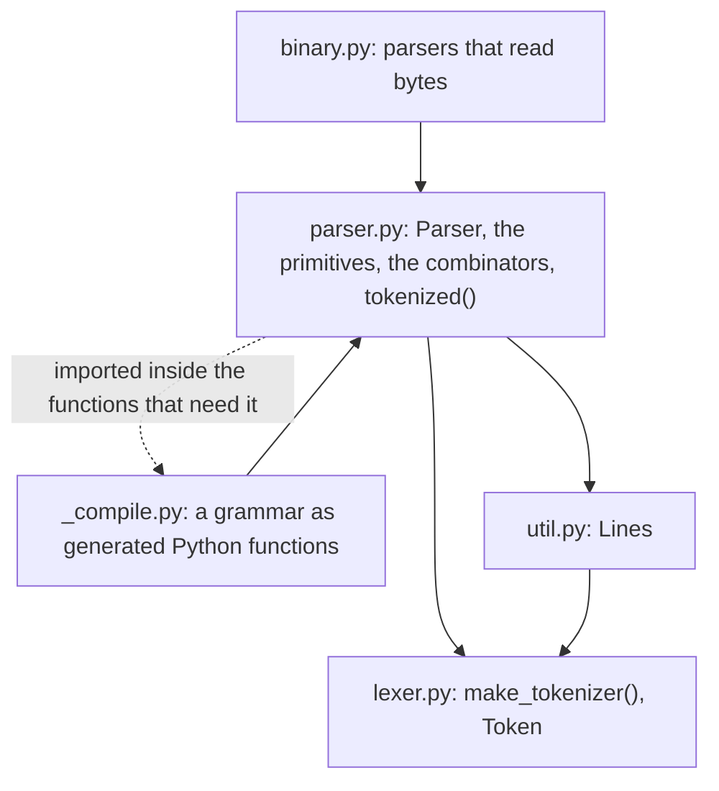
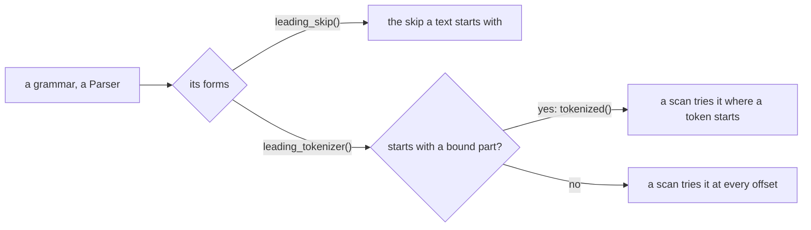
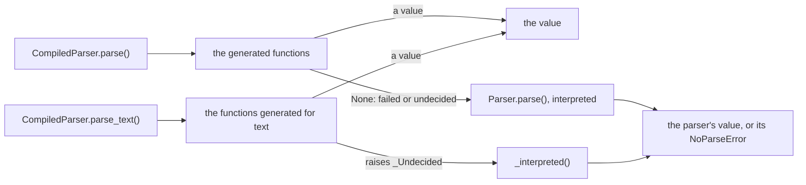
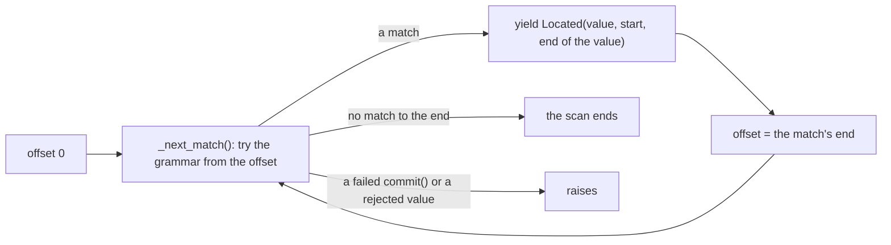

# Architecture

How funcparserlib is put together, and the principles a change keeps. Each decision behind them is a record in
[the ADRs](docs/adr/index.md); read the ones a change touches before proposing it.



An arrow is "imports". `parser.py` reaches `_compile.py` only from inside the functions that need it:
`Parser.compile()`, `Parser.parse_text()`, `Parser.scan_text()` and a compiled parser's scans. That breaks the cycle
between the two.

## Codemap

```text
funcparserlib/parser.py   Parser, the primitives (tok, a, some, lit, regex, skipping, forward_decl, finished), tokenized, the combinators, the results
funcparserlib/lexer.py    make_tokenizer, TokenSpec, Token, LexerError
funcparserlib/binary.py   regex(), lit(), fixed(), byte(), previous(), parsers that read bytes; experimental
funcparserlib/_compile.py Parser.compile(): a grammar as generated Python functions
funcparserlib/util.py     Lines, pretty_tree, expand_tuple_args
funcparserlib/_commons.py the generated helpers: valueclass, refclass, with_hint
funcparserlib/_utils.py   the package's own helpers: the line and column of an offset
tests/test_*.py           unit tests; tests/dot.py and tests/json.py are example grammars they drive
tests/shadow.py           pytest plugin: every parse of the suite also runs compiled, and must agree
```

## A grammar is one parser

A grammar is a `Parser`, built from parsers with operators, functions and methods, each form saying what it does
(ADR 0008). A grammar has one definition of its language (ADR 0004), in one of three kinds:

- **A token grammar** reads a sequence of tokens. Its language is the tokens its tokenizer gives for the whole text,
  read from the start: a position inside one of those tokens is no place a token grammar starts.
- **A grammar without a tokenizer** reads text at the position it has reached, with `lit()`, `regex()` and the parsers
  of `skipping()`, and a parser of text skips what follows it.
- **A token grammar bound to its tokenizer**, `tokenized()`, is a parser of text (ADR 0003). From the start of a text
  it reads the tokens of the text; inside a grammar of text it reads them from where it is reached.

What a grammar can read first decides where it starts: the skip a text starts with (`leading_skip()`), and where a
scan tries it, at every offset or only where a token of the text starts (`leading_tokenizer()`). A rule that depends
on the kind of a grammar is decided there, from the forms of the grammar, so it holds through `>>`, `located()`, `+`
and every other combinator. A rule given to one parser object, as a method of it, holds only where that object is the
root.



## The parser decides, generated code follows

The interpreted parser is the definition of what a grammar gives and of every error (ADR 0002). `Parser.compile()`
generates code for the parses that succeed; where that code cannot decide, it gives the decision back to the parser,
which also makes every error. A compiled parser gives what its parser gives.

That is checked by comparing the two on inputs nobody chose, which finds what tests written by hand miss:

- the property tests run random grammars of each kind, compiled and interpreted, and compare what they give, parse
  and scan alike, and fail when a form of generated code is out of their reach;
- the `shadow` session runs every parse and scan of the suite and of the docs on the compiled parser too, and
  compares each result.

A form a new combinator adds to generated code is added to the random grammars in the same change.



## Positions

`State.pos` is an index into what is parsed, and `State._skipped` how much the last parser of text skipped after its
value, so a span ends where its value ends, before the skip (ADR 0009). Generated code carries the same end beside
the position, and keeps it wherever its paths join, as the parser keeps its state. A position in text is an offset;
`Lines` turns it into a line and a column, and tokens carry their line and column themselves.

## Scans

A scan tries a grammar at each position of its input, lazily, and goes past each match: `scan()` at each index of a
sequence of tokens, `scan_text()` at each offset of a text, or at each token of the text for a grammar that starts
with a bound part (ADR 0003, ADR 0009). A failed `commit()` or a rejected value raises, so a migration stops at a
broken construct. The tokens of another library, as markdown-it's, are scanned as they are, since such a tokenizer
reads a whole document and cannot start inside one.



[How a scan walks a text](docs/explanation/scans.md) steps through it interactively.

## Invariants

Rule, then what enforces it. Challenge one in discussion rather than routing around it.

- **No runtime dependencies.** `dependencies = []` in `pyproject.toml`; `just deps`.
- **A grammar written for 1.0 parses to the same value, and its errors say what each doc example
  says.** The doctests in `docs/` and in the docstrings (pytest's `--doctest-glob` and
  `--doctest-modules`), which compare error messages too, `tests/test_parsing.py`.
- **The combinators' types are the product.** What `p1 + p2`, `-p`, `p1 | p2`, `p >> f`, `many()`,
  `maybe()`, `forward_decl()` infer for a user is asserted in `typing_tests/` (`just types-api`,
  ADR 0001).
- **An error names everything expected where parsing stopped**, a label instead of a parser's parts, and an error
  from a nested `parse()` unchanged. `tests/test_errors.py`.
- **Values are `@valueclass`**: `Token`, `TokenSpec`, `State` and the parsing results are frozen to
  type checkers and assign their fields directly at runtime. The conventions runner, CON513.
- **`Parser` is the one exported class open to subclassing**; everything else exported is `@final`.
  `[tool.conventions.subclassable]`, CON200.
- **A compiled parser gives what its parser gives.** The nox sessions `shadow` and `exhaustive`, and
  the property tests, which fail if a form of generated code is out of their reach (ADR 0002).
- **The docs pages are tests.** A `>>>` session in `docs/` or `README.md` runs under pytest. `examples/` is
  type-checked and run (`just types`, `tests/examples/test_examples.py`).
- **The package runs on the floor; what it teaches uses the newest syntax.** The package and `tests/` are
  written for `requires-python`, the oldest supported CPython. `examples/`, `docs/` and `README.md` are written
  for the version ruff's `per-file-target-version` gives `examples/**`, which the type checkers read and below
  which `conftest.py` leaves them out of the tests. The floor's nox sessions, ADR 0001.

## What stays out

A concrete syntax tree is no part of the library: a migration keeps the text outside its constructs, which spans
give, and the layout of a file read by another library is that library's (ADR 0009).
